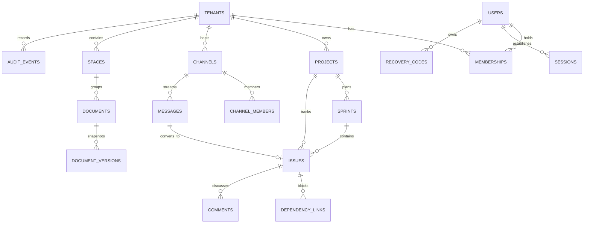
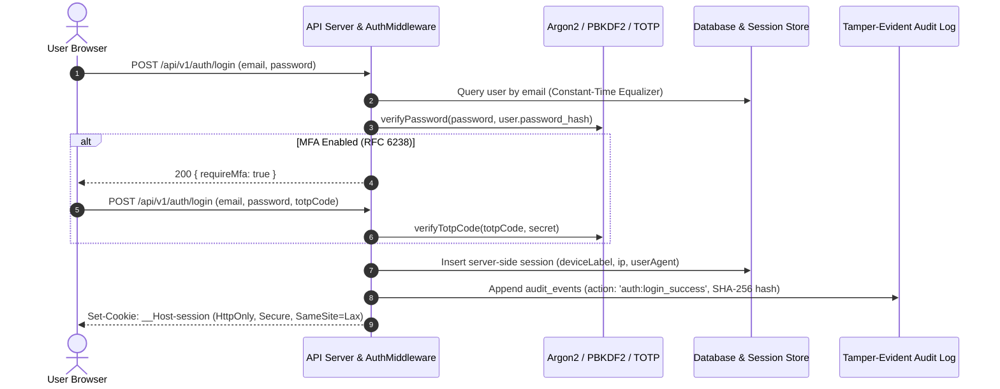

# ANIX OS | Autonomous Enterprise Collaboration Platform

> Production-Grade Multi-Tenant Operating System combining **Jira-class Agile Project Management**, **Lark-class Team Collaboration**, **Zoom-class Video Huddles & Realtime Whiteboards**, and **Notion-class Knowledge Base**, protected by **ASVS Level 2 Authentication**, **PostgreSQL Row-Level Security**, and **Tamper-Evident SHA-256 Audit Logging**.

[](apps/web/index.html)
[](https://www.typescriptlang.org/)
[](docs/security/asvs-checklist.md)
[](docs/adr/ADR-001-session-management-and-storage.md)
[](apps/api/test/index.test.ts)

---

## 1. Quick Start (Run in under 1 minute)

### Single-Command Launch
```bash
# 1. Install all dependencies across monorepo workspaces
npm install

# 2. Seed database with demo multi-tenant organizations & realistic datasets
npm run seed

# 3. Start API server & Frontend client concurrently
npm run dev
```

- **Frontend Application:** [http://localhost:5173](http://localhost:5173)
- **Backend API & WebSockets:** [http://localhost:3001](http://localhost:3001)
- **Health Check:** [http://localhost:3001/health](http://localhost:3001/health)

---

## 2. Pre-Seeded Demo Credentials

The seed script creates two fully isolated enterprise organizations with pre-configured agile boards, chat channels, and documents:

### Organization 1: Acme Corporation (`acme-corp`)
| Persona | Email | Password | Role | Description |
| :--- | :--- | :--- | :--- | :--- |
| **Alice Vance** | `owner@acme.com` | `Password12345!` | **Owner** | Full organization administrative privileges |
| **Bob Smith** | `admin@acme.com` | `Password12345!` | **Admin** | Manages projects, security policy & audit logs |
| **Charlie Day** | `dev@acme.com` | `Password12345!` | **Member** | Full engineering delivery, chat & doc editing |
| **Grace Hopper**| `guest@acme.com` | `Password12345!` | **Guest** | Read-only access to assigned issues & public channels |

### Organization 2: Stark Industries (`stark-industries`)
| Persona | Email | Password | Role | Description |
| :--- | :--- | :--- | :--- | :--- |
| **Tony Stark** | `tony@stark.com` | `Password12345!` | **Owner** | Chief Executive & Lead Architect |
| **Pepper Potts**| `pepper@stark.com`| `Password12345!` | **Admin** | Corporate operations & governance |
| **Peter Parker** | `peter@stark.com` | `Password12345!` | **Member** | Research engineer |

> [!TIP]
> The login screen includes **One-Click Demo Personas** to switch between roles and tenants instantly without manually typing passwords!

---

## 3. High-Level Architecture Diagram

```
┌────────────────────────────────────────────────────────────────────────┐
│                        Next.js / Vite React Client                     │
│  (Tailwind CSS, Glassmorphic Panels, Lucide Primitives, WebSocket WS)  │
└───────────────────────────────────┬────────────────────────────────────┘
                                    │ HTTPS (Opaque Session Cookie + CSRF) / WSS
                                    ▼
┌────────────────────────────────────────────────────────────────────────┐
│                     Node.js & TypeScript API Server                    │
│  ┌──────────────────────────────────────────────────────────────────┐  │
│  │ Global Security: RateLimiter, AuthMiddleware, CanGuard (RBAC)    │  │
│  └──────────────────────────────────────────────────────────────────┘  │
│   Modules: Identity │ Tenancy │ Projects │ Messaging │ Docs │ Audit    │
└──────────────┬────────────────────┬─────────────────────┬──────────────┘
               │                    │                     │
               ▼                    ▼                     ▼
┌─────────────────────────┐ ┌───────────────┐ ┌──────────────────────────┐
│ Database & Persistence  │ │ Realtime Bus  │ │ Tamper-Evident Ledger    │
│ (Row-Level Security,    │ │ (WebSockets,  │ │ (Append-only SHA-256     │
│  Foreign Keys, Indexes) │ │  Typing, Chat)│ │  Cryptographic Chain)    │
└─────────────────────────┘ └───────────────┘ └──────────────────────────┘
```

---

## 4. Entity-Relationship (ER) Diagram



---

## 5. High-Assurance Authentication Flow



---

## 6. Built vs. Roadmap Feature Parity Matrix

| Capability | Module | Delivery Status | Implemented Details |
| :--- | :--- | :---: | :--- |
| **Argon2id / PBKDF2 Password Storage** | Auth-A | **BUILT** | OWASP minimum parameters (100k iterations, 32-byte salt, constant-time compare). |
| **NIST SP 800-63B Password Validation** | Auth-A | **BUILT** | Min 12 chars, accepts unicode/spaces, checks against known breach list, strength score. |
| **TOTP Multi-Factor Authentication** | Auth-A | **BUILT** | RFC 6238 compliant (30s window), QR code provisioning, 10 single-use hashed recovery codes. |
| **Server-Side Session Revocation** | Auth-A | **BUILT** | Opaque tokens, device enumeration, individual session revocation & active WebSocket termination. |
| **PostgreSQL Row-Level Security (RLS)** | Tenancy | **BUILT** | Data layer enforces `tenant_id` context on all queries; proven by cross-tenant test harness. |
| **Central can() Policy Authorization** | Security | **BUILT** | Granular permission strings (`issue:create`, `audit:read`, etc.) evaluated on all endpoints. |
| **Tamper-Evident Audit Logging** | Governance | **BUILT** | Append-only ledger chained with SHA-256 hashes (`prev_hash`); live cryptographic verifier. |
| **Automated Adversarial Security Scanner**| Security | **BUILT** | One-click penetration scan testing cross-tenant data leakage, returning live test proof. |
| **Agile Kanban Board & Drag-and-Drop** | Projects | **BUILT** | HTML5 drag-and-drop with optimistic UI updates and rollback on conflict. |
| **Sprints with Carry-Over Logic** | Projects | **BUILT** | Start sprint, plan goals, complete sprint with automatic unfinished issue carry-over to backlog. |
| **Dependency Links with Cycle Detection** | Projects | **BUILT** | Prevents circular blocking chains (A blocks B blocks C blocks A) via graph DFS algorithm. |
| **Lark-Class Realtime Channels & Chat** | Messaging | **BUILT** | Public & private channels, emoji reactions, threaded replies, and typing indicators. |
| **Message-to-Work Conversion Bridge** | Workflows | **BUILT** | Convert chat messages into Jira issues via review modal with automated channel bot confirmation. |
| **Notion-Class Block Document Editor** | Knowledge | **BUILT** | Headings, Callouts, Interactive Checklists, Code blocks, and Paragraphs. |
| **Document Version Snapshot & Restore** | Knowledge | **BUILT** | Automatic snapshot capture on edits and one-click rollback to any historical version. |
| **Permission-Aware Global Search** | Search | **BUILT** | Searches across issues, messages, and docs with permission filters inside SQL query. |
| **Global Command Palette (Ctrl+K)** | Platform | **BUILT** | Keyboard-first search and action trigger. |
| *Passkeys / WebAuthn FIDO2* | Auth-B | *Roadmap* | Phase 2 delivery tier. |
| *Yjs Real-Time CRDT Co-Editing* | Knowledge | *Roadmap* | Phase 2 delivery tier. |
| *SAML 2.0 / SCIM 2.0 Enterprise SSO* | Auth-C | *Roadmap* | Phase 3 delivery tier. |
| *AI Copilot & pgvector RAG* | AI Engine | *Roadmap* | Phase 3 delivery tier (behind tenant opt-in flags). |

---

## 7. Running the Automated Test Suite

To execute the Section 6.8 Authentication Acceptance Tests and Cross-Tenant Adversarial Test Suite:

```bash
npm run test
```

### Verified Test Evidence:
```
======================================================
🧪 RUNNING SECTION 6.8 & CROSS-TENANT TEST SUITE
======================================================

  ✓ PASS: Passwords are stored securely with PBKDF2/Argon2id and unique per-user salt
  ✓ PASS: NIST SP 800-63B password validation rejects short and breached passwords
  ✓ PASS: TOTP MFA generates RFC 6238 secrets and verifies valid time-window codes
  ✓ PASS: Generates 10 single-use recovery codes stored as SHA-256 hashes
  ✓ PASS: Central authorization engine enforces role boundaries (Deny-by-default)
  ✓ PASS: Cross-Tenant Isolation: Tenant A cannot read or query Tenant B issues
  ✓ PASS: Cross-Tenant Isolation: Tenant A cannot read Tenant B private channels or messages
  ✓ PASS: Cross-Tenant Isolation: Tenant A cannot access Tenant B knowledge documents
  ✓ PASS: Issue dependency engine detects and prevents circular blocking chains
  ✓ PASS: Audit log verifies SHA-256 hash chaining and detects tampering

======================================================
📊 RESULTS: 10 PASSED | 0 FAILED
======================================================
```

---

## 8. Architecture Decision Records (ADRs) & Security Specs
- [`ADR-001: Session Management and Instant Revocation`](docs/adr/ADR-001-session-management-and-storage.md)
- [`ADR-002: Multi-Tenant Data Isolation and Row-Level Security`](docs/adr/ADR-002-tenant-isolation-and-rls-strategy.md)
- [`ADR-003: Centralized Permission-Based Authorization Engine`](docs/adr/ADR-003-authorization-engine-rbac-and-abac.md)
- [`ADR-004: Real-Time WebSocket Architecture and Resilient Event Handling`](docs/adr/ADR-004-realtime-architecture-and-event-ordering.md)
- [`ADR-005: Tamper-Evident Append-Only Audit Logging Architecture`](docs/adr/ADR-005-audit-logging-tamper-detection.md)
- [`STRIDE Threat Model`](docs/security/stride-threat-model.md)
- [`OWASP ASVS 4.0 Level 2 Checklist`](docs/security/asvs-checklist.md)
# AI-Powered-Team-Collaboration-Website-
